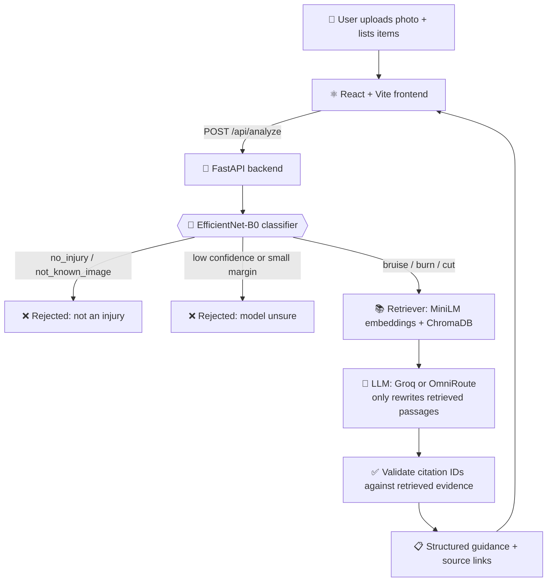

<div align="center">

# 🩹 WoundGuide

### AI First-Aid Assistant — classify an injury photo, get source-cited first-aid guidance


</div>

<!--
  TIP: add a screenshot here after you run the app, e.g.
  1. Save it as docs/screenshot.png
  2. Replace this comment with:  
-->

> [!WARNING]
> **Not a medical device.** WoundGuide is an educational college project. It does **not** diagnose, does **not** judge severity, and has **not** been clinically validated. For heavy bleeding, deep or large wounds, serious burns, worsening symptoms, or any doubt — get professional medical care.

---

## 📑 Table of Contents

1. [What it does](#-what-it-does)
2. [How it works](#-how-it-works)
3. [Tech stack](#-tech-stack)
4. [Project structure](#-project-structure)
5. [Run it on your machine (step by step)](#-run-it-on-your-machine-step-by-step)
6. [Using the app](#-using-the-app)
7. [API reference](#-api-reference)
8. [Configuration (`.env`)](#-configuration-env)
9. [Optional: rebuild the RAG knowledge index](#-optional-rebuild-the-rag-knowledge-index)
10. [Troubleshooting](#-troubleshooting)
11. [Known limitations](#-known-limitations)

---

## ✨ What it does

| | Feature |
|---|---|
| 📷 | Upload a photo of a **cut, burn or bruise** |
| 🧠 | **EfficientNet-B0** classifies it into 5 classes |
| 🚫 | Photos of healthy skin or unrelated objects are **rejected** (no medical guidance is generated) |
| 📚 | **RAG**: retrieves passages from reviewed sources (NHS, MedlinePlus, Red Cross) stored in a local ChromaDB |
| 🧰 | **Item-aware advice**: tell it what you have (clean water, cloth, gauze, bandage, ice pack, soap) |
| 🔗 | **Clickable citations** next to individual guidance statements |
| ⚠️ | Low-confidence predictions are refused instead of guessed |

**Class order** (checkpoint and `backend/app/config.py` must match exactly):

`bruise` · `burn` · `cut` · `no_injury` · `not_known_image`

Only `bruise`, `burn` and `cut` proceed to first-aid retrieval.

---

## 🔬 How it works



**In plain words:** the image model decides *what kind* of injury it is → the retriever finds matching passages from trusted sources → the LLM only *rephrases* those passages into short steps → the backend checks every citation ID is real before the UI shows it. If retrieval or the LLM fails, **no guidance is generated** (there is no silent medical fallback).

---

## 🧰 Tech stack

| Layer | Tools |
|---|---|
| Frontend | React 18, Vite 5 |
| Backend | Python 3.11, FastAPI, Uvicorn |
| Classifier | PyTorch, Torchvision, EfficientNet-B0 (`best_wound_model_v2.pth`, 16 MB, included in repo) |
| Retrieval | ChromaDB, Sentence-Transformers (`all-MiniLM-L6-v2`) |
| Source ingestion | Requests, Beautiful Soup |
| LLM | Groq (default) or any OpenAI-compatible OmniRoute endpoint |

---

## 🗂 Project structure

```text
ML-Project/
├── backend/
│   ├── app/
│   │   ├── api/routes.py            # /api/health and /api/analyze
│   │   ├── ml/predictor.py          # loads the model, predicts class
│   │   ├── rag/retriever.py         # ChromaDB retrieval
│   │   ├── llm/                     # Groq + OmniRoute providers
│   │   ├── config.py                # reads .env, class order
│   │   └── main.py                  # FastAPI app + CORS
│   ├── data/
│   │   ├── chroma/                  # ready-made vector index (45 passages)
│   │   ├── sources/                 # approved_sources.json, snapshots.jsonl
│   │   └── knowledge_base.json      # item/material aliases
│   ├── models/best_wound_model_v2.pth
│   ├── scripts/                     # ingest → approve → index → test
│   ├── verify_model.py
│   ├── requirements.txt
│   └── .env.example
├── frontend/
│   ├── src/ (main.jsx, style.css)
│   ├── package.json
│   └── .env.example
└── README.md
```

> The trained model and the ChromaDB index are **already in the repository**, so you do **not** need to train anything or build the index to run the app.

---

## 🚀 Run it on your machine (step by step)

You will open **two terminals**: one for the backend, one for the frontend. Total time: about 15–25 minutes (mostly downloads).

### Step 0 — Install the prerequisites (one time)

| Tool | Version | Download |
|---|---|---|
| Git | any recent | https://git-scm.com/downloads |
| Python | **3.11** recommended | https://www.python.org/downloads/ — on Windows, tick **"Add python.exe to PATH"** in the installer |
| Node.js | **20 or newer** (includes npm) | https://nodejs.org (choose LTS) |
| Groq API key | free account | https://console.groq.com/keys → **Create API Key** → copy it (starts with `gsk_`) |

Check they installed. Open a terminal (Windows: press `Win`, type **PowerShell**, Enter. Mac: press `Cmd+Space`, type **Terminal**, Enter) and type:

```bash
git --version
python --version      # Mac/Linux: python3 --version
node --version
npm --version
```

Each must print a version number. If one says "not recognized" or "command not found", reinstall that tool and **restart the terminal**.

### Step 1 — Clone the project

```bash
git clone https://github.com/AryanTomar-codecollege/ML-Project.git
cd ML-Project
```

### Step 2 — Backend: create a virtual environment and install packages

> ⏳ This downloads PyTorch and other large packages (can take 5–15 minutes). Do not close the terminal.

**Windows (PowerShell)**

```powershell
cd backend
py -3.11 -m venv .venv
.\.venv\Scripts\Activate.ps1
python -m pip install --upgrade pip
pip install -r requirements.txt
Copy-Item .env.example .env
```

If activation fails with a "running scripts is disabled" error, run `Set-ExecutionPolicy -Scope Process Bypass`, press `Y`, then run the activate line again.

**macOS / Linux**

```bash
cd backend
python3.11 -m venv .venv
source .venv/bin/activate
python -m pip install --upgrade pip
pip install -r requirements.txt
cp .env.example .env
```

✅ **Success check:** your prompt now starts with `(.venv)`. If it does not, the environment is not active — run the activate line again.

### Step 3 — Add your Groq API key

Open the file `backend/.env` in any editor (Notepad, VS Code) and fill in the key:

```env
LLM_PROVIDER=groq
GROQ_API_KEY=gsk_paste_your_key_here
```

Save the file. **Never commit `.env` or share your key** (`.env` is already in `.gitignore`).

> Prefer a different provider? See [Configuration](#-configuration-env) for OmniRoute.

### Step 4 — Download the embedding model (one time, needs internet)

The backend loads the embedding model in **offline mode** (`local_files_only=True`), so it must already be on your computer. Download it once (still inside `backend/` with `(.venv)` active):

```bash
python -c "from sentence_transformers import SentenceTransformer; SentenceTransformer('sentence-transformers/all-MiniLM-L6-v2'); print('Embedding model ready')"
```

✅ Expected last line: `Embedding model ready`.
⚠️ **If you skip this step**, the app starts but `/api/health` shows `"rag_mode": "unavailable"` and every analysis fails with a 503 error.

### Step 5 — Verify the model and the knowledge index

```bash
python verify_model.py models/best_wound_model_v2.pth
```

✅ Expected:

```text
Model loaded successfully.
Class-index mapping:
  0 -> bruise
  1 -> burn
  2 -> cut
  3 -> no_injury
  4 -> not_known_image
```

```bash
python scripts/test_retrieval.py
```

✅ Expected: it prints `Mode: rag` and `RAG error: None`, followed by a few retrieved passages about cuts.

### Step 6 — Start the backend (Terminal 1)

```bash
uvicorn app.main:app --reload --host 127.0.0.1 --port 8000
```

The first start takes 10–30 seconds (loading PyTorch and the embedding model). When you see `Application startup complete`, leave this terminal **running**.

Now open **http://127.0.0.1:8000/api/health** in your browser. You must see:

```json
{
  "status": "ok",
  "provider": "groq",
  "model_loaded": true,
  "rag_mode": "ready",
  "rag_error": null,
  "classes": ["bruise", "burn", "cut", "no_injury", "not_known_image"]
}
```

If `model_loaded` is `false` or `rag_mode` is `unavailable`, jump to [Troubleshooting](#-troubleshooting) before going further.

### Step 7 — Start the frontend (Terminal 2)

Open a **new** terminal window (keep the backend running) and go to the project folder:

**Windows (PowerShell)**

```powershell
cd path\to\ML-Project\frontend
npm install
Copy-Item .env.example .env
npm run dev
```

**macOS / Linux**

```bash
cd path/to/ML-Project/frontend
npm install
cp .env.example .env
npm run dev
```

(Replace `path\to\ML-Project` with where you cloned it, e.g. `cd Desktop\ML-Project\frontend`.)

`frontend/.env` must contain `VITE_API_URL=http://127.0.0.1:8000` (the example file already does). The terminal will print a link — open **http://127.0.0.1:5173** in your browser.

> The frontend **must** run on port `5173` (the backend only allows that address through CORS). If port 5173 is busy, Vite will stop with an error instead of picking another port — close whatever is using it and run `npm run dev` again.

🎉 **Done.** You should see the WoundGuide page.

---

## 🖥 Using the app

1. Click **Start an analysis**.
2. **Add a photo** — drag and drop, or click to choose (JPG / PNG / WEBP, max 10 MB). Use a clear, well-lit photo of a single injury.
3. **Pick the items you have** (clean water, clean cloth, gauze, bandage, ice pack, soap) or type your own, separated by commas.
4. Click **Get first-aid guidance**.
5. Read the predicted class, confidence, *What to do*, *What not to do*, item tips, *Good signs* and *Warning signs*.
6. Click the **Source** links and check the page really supports that instruction.

Good test set: one cut, one burn, one bruise, one healthy-skin photo, one unrelated object (should be rejected).

---

## 📡 API reference

Interactive docs: **http://127.0.0.1:8000/docs**

| Method | Endpoint | Purpose |
|---|---|---|
| `GET` | `/` | Simple "API is running" message |
| `GET` | `/api/health` | Model status, RAG status, provider, class list |
| `POST` | `/api/analyze` | Analyze an image |

`POST /api/analyze` takes `multipart/form-data`:

| Field | Type | Example |
|---|---|---|
| `image` | file | `cut.jpg` |
| `items` | text (comma separated) | `clean water, bandage` |

Possible responses: `200` with guidance, `200` with `"rejected": true` (not an injury / model unsure), `400` bad image, `413` image too large, `502` LLM failed, `503` RAG unavailable.

Try it from a terminal (macOS/Linux, or Windows with `curl.exe`):

```bash
curl -X POST http://127.0.0.1:8000/api/analyze -F "image=@cut.jpg" -F "items=clean water, bandage"
```

---

## ⚙️ Configuration (`.env`)

All settings live in `backend/.env` (copied from `.env.example`).

| Variable | Default | Meaning |
|---|---|---|
| `MODEL_PATH` | `models/best_wound_model_v2.pth` | Classifier checkpoint |
| `LLM_PROVIDER` | `groq` | `groq` or `omniroute` |
| `GROQ_API_KEY` | *(empty)* | **Required** for the Groq provider |
| `GROQ_MODEL` | `openai/gpt-oss-120b` | Check your Groq account for model availability and limits |
| `OMNIROUTE_BASE_URL` / `OMNIROUTE_API_KEY` / `OMNIROUTE_MODEL` | `http://localhost:20128/v1` / empty / `auto` | Only if using OmniRoute |
| `MAX_IMAGE_MB` | `10` | Upload size limit |
| `MIN_CONFIDENCE` | `55` | Below this, the prediction is rejected as "unsure" |
| `MIN_MARGIN` | `12` | Minimum gap between top-2 class probabilities |
| `RAG_ENABLED` | `true` | Turn retrieval on/off |
| `RAG_DB_PATH` | `data/chroma` | Vector DB folder |
| `RAG_COLLECTION` | `first_aid_guidance` | Must match the index |
| `RAG_EMBEDDING_MODEL` | `sentence-transformers/all-MiniLM-L6-v2` | Must match the model used to build the index |
| `RAG_MIN_SCORE` | `0.25` | Minimum similarity for a passage to be used |

<details>
<summary><b>Using OmniRoute instead of Groq</b></summary>

Only if you already have an OpenAI-compatible OmniRoute endpoint running:

```env
LLM_PROVIDER=omniroute
OMNIROUTE_API_KEY=your_key_if_required
OMNIROUTE_BASE_URL=http://localhost:20128/v1
OMNIROUTE_MODEL=auto
```

Restart the backend after editing `.env`.
</details>

---

## 🔄 Optional: rebuild the RAG knowledge index

**You don't need this to run the project** — the index is already included. Do this only if you want to change the sources in `backend/data/sources/approved_sources.json`.

Run from `backend/` with `(.venv)` active, in this order:

```bash
python scripts/ingest_sources.py                       # 1. download pages -> data/sources/snapshots.jsonl
# 2. MANUALLY open snapshots.jsonl and check every record's URL, text and injury label.
#    Delete or fix anything wrong or irrelevant.
python scripts/approve_sources.py --approve-reviewed   # 3. marks ALL records as human-reviewed
python scripts/index_sources.py                        # 4. rebuilds data/chroma (deletes the old index!)
python scripts/test_retrieval.py                       # 5. must print "Mode: rag"
```

> ⚠️ Step 3 is a statement that **you** reviewed everything — never run it before step 2. Step 4 **deletes and recreates** `data/chroma`. Some websites block automated downloads, so a few sources may be skipped.

---

## 🛠 Troubleshooting

<details>
<summary><b><code>"rag_mode": "unavailable"</code> in /api/health, or 503 error in the UI</b></summary>

Most common cause: the embedding model was never downloaded. Run the Step 4 command again (with internet on), restart the backend, then re-check `/api/health`. The `rag_error` field in the health response tells you the exact reason.
</details>

<details>
<summary><b><code>model_loaded: false</code> / "Model not found" / class-order error</b></summary>

Make sure `backend/models/best_wound_model_v2.pth` exists, that you cloned the full repository, and that `MODEL_PATH` in `.env` is correct. Run `python verify_model.py models/best_wound_model_v2.pth` and read the error.
</details>

<details>
<summary><b>"No module named ..." / "uvicorn is not recognized"</b></summary>

The virtual environment is not active. `cd backend`, activate it (`.\.venv\Scripts\Activate.ps1` on Windows, `source .venv/bin/activate` on Mac/Linux), confirm `(.venv)` shows in the prompt, then `pip install -r requirements.txt` again.
</details>

<details>
<summary><b>PyTorch installation fails</b></summary>

Use Python 3.11, upgrade pip (`python -m pip install --upgrade pip`), and retry. If it still fails, install a PyTorch/Torchvision build for your OS from https://pytorch.org/get-started/locally/ and then run `pip install -r requirements.txt` again.
</details>

<details>
<summary><b>"AttributeError: ... has no attribute 'encode_query'"</b></summary>

Your `sentence-transformers` is too old (the code needs version 5 or newer). Run `pip install -U "sentence-transformers>=5.0,<6.0"` and restart the backend.
</details>

<details>
<summary><b>502 error: "The configured LLM provider failed"</b></summary>

Check that `GROQ_API_KEY` is set in `backend/.env` (no spaces or quotes), that your Groq account can use the model in `GROQ_MODEL`, that you have not hit a rate limit, and that you are online. Restart the backend after any `.env` change.
</details>

<details>
<summary><b>Frontend shows "Failed to fetch" / cannot reach backend</b></summary>

Confirm the backend terminal is still running and `http://127.0.0.1:8000/api/health` opens. Confirm `frontend/.env` has `VITE_API_URL=http://127.0.0.1:8000`, then stop and restart `npm run dev` (Vite reads `.env` only at start). Open the app at `127.0.0.1:5173` or `localhost:5173` — other ports are blocked by CORS.
</details>

<details>
<summary><b>"Port 5173 is already in use" / "port 8000 already in use"</b></summary>

Another program (or an old terminal of this project) is using the port. Close it and start again. For the backend you may use another port with `--port 8001`, but then update `VITE_API_URL` and add that origin to the CORS list in `backend/app/main.py`.
</details>

<details>
<summary><b>Windows: <code>py -3.11</code> not found</b></summary>

Install Python 3.11 from python.org (tick "Add python.exe to PATH" and "py launcher"), reopen PowerShell, and retry. Check with `py -0` which versions are installed.
</details>

---

## ⚠️ Known limitations

- The classifier can misclassify unfamiliar images and is not clinically validated. **Confidence ≠ medical accuracy.**
- Rejection of non-injury images is not guaranteed for every unfamiliar picture.
- A valid citation ID does not prove that the source semantically supports a statement — **open the source and check.**
- The `bruise` category currently includes an NHS *black eye* page, so an eye-specific source can appear for a bruise elsewhere on the body. Review retrieved passages.
- The index holds 45 passages from 8 sources; 3 of the 11 sources in `approved_sources.json` have no snapshot (the websites likely blocked automated download).
- LLM provider model names, limits and pricing can change.

---

## 🔐 Security & privacy

- Keep `.env` and API keys private; never commit them.
- Do not upload sensitive or identifiable personal images.
- Do not expose the development server to the public internet.
- Only ingest sources you are allowed to use.

---

<div align="center">

**WoundGuide** — educational college project · Not a diagnostic tool · Always seek professional care when in doubt

Made by [Aryan Tomar](https://github.com/AryanTomar-codecollege)

</div>