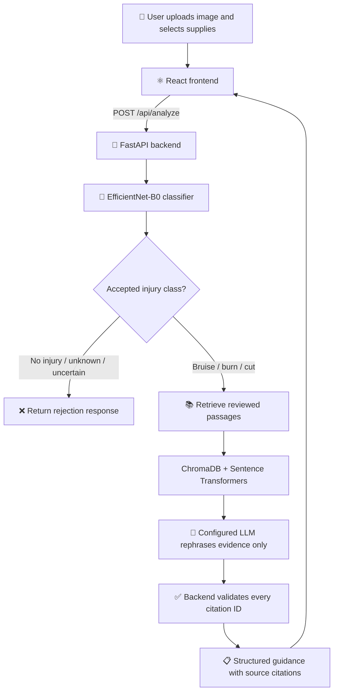

<div align="center">

# 🩹 WoundGuide

### AI-Powered First-Aid Guidance with Image Classification & Retrieval-Augmented Generation

**Classify an image · Retrieve first-aid evidence · Open source citations**


</div>

<!--
  TIP: after running the app, save a screenshot as docs/screenshot.png and
  replace this comment with:  
-->

> [!IMPORTANT]
> WoundGuide is an **educational college-project prototype, not a medical device**. It does not diagnose injuries or reliably determine their severity. Do not use it instead of professional medical advice. Seek urgent medical care for severe or uncontrolled bleeding, deep or large wounds, serious burns, rapidly worsening symptoms, or any emergency. The model's confidence score and a clickable citation do **not** guarantee that the advice is correct.

---

## 📑 Table of Contents

- [Overview](#-overview)
- [Features](#-features)
- [How It Works](#-how-it-works)
- [Model Classes](#️-model-classes)
- [Technology Stack](#-technology-stack)
- [Repository Structure](#-repository-structure)
- [Prerequisites](#-prerequisites)
- [Setup and Run (step by step)](#-setup-and-run-step-by-step)
- [First-Run Checklist](#-first-run-checklist)
- [Using the App](#-using-the-app)
- [API Overview](#-api-overview)
- [Configuration (`.env`)](#️-configuration-env)
- [Optional: Rebuild the RAG Index](#-optional-rebuild-the-rag-index)
- [Understanding Source Citations](#-understanding-source-citations)
- [Troubleshooting](#️-troubleshooting)
- [Security and Data Handling](#-security-and-data-handling)
- [Disclaimer](#️-disclaimer)

---

## 📌 Overview

WoundGuide combines a trained image classifier with **retrieval-augmented generation (RAG)** to present first-aid information grounded in a local index of reviewed source pages (NHS, MedlinePlus, American Red Cross).

The React frontend uploads an image to a FastAPI backend. The backend predicts a class, retrieves relevant passages from ChromaDB, and uses a configured language-model provider to rephrase **only the retrieved evidence** into short steps with source citations. If retrieval or the LLM fails, **no guidance is generated** — there is no silent medical fallback.

The project demonstrates an end-to-end AI application. It has **not** been clinically validated.

---

## ✨ Features

| | Feature |
|---|---|
| 🖼️ | Image classification with an **EfficientNet-B0** model |
| 🧭 | Five classes: `bruise`, `burn`, `cut`, `no_injury`, `not_known_image` |
| 🛑 | **Rejection handling** for `no_injury`, `not_known_image`, and low-confidence predictions (configurable thresholds) |
| 📚 | **RAG retrieval** using ChromaDB and Sentence Transformers |
| 🔗 | **Clickable source links** beside individual guidance statements when the backend returns valid citations |
| 🧰 | **Item-aware** suggestions based on supplies the user has (clean water, cloth, gauze, bandage, ice pack, soap, or custom) |
| ⚡ | FastAPI health endpoint and interactive API docs |
| 🧩 | Configurable LLM provider: **Groq** or an OpenAI-compatible **OmniRoute** endpoint |

---

## 🔄 How It Works



1. **Classify** — the image model predicts the injury type.
2. **Gate** — non-injury, unknown, or uncertain results are rejected; no medical text is produced.
3. **Retrieve** — passages for that injury (and for each supply the user listed) are fetched from the local ChromaDB index.
4. **Rephrase** — the LLM may only use those passages and must cite their IDs.
5. **Validate** — the backend discards any citation ID that was not in the retrieved evidence, then the UI shows the links.

---

## 🏷️ Model Classes

The model checkpoint and `backend/app/config.py` must use this **exact** class order:

| Index | Class | Expected handling |
|:---:|---|---|
| 0 | `bruise` | Continue to first-aid guidance |
| 1 | `burn` | Continue to first-aid guidance |
| 2 | `cut` | Continue to first-aid guidance |
| 3 | `no_injury` | Reject injury guidance |
| 4 | `not_known_image` | Reject injury guidance |

> [!WARNING]
> A classifier can still label an unfamiliar image incorrectly. The `not_known_image` class is **not** a guarantee of robust out-of-distribution detection, and a high confidence score is **not** the same as medical accuracy.

---

## 🧱 Technology Stack

| Layer | Technologies |
|---|---|
| Frontend | React 18, Vite 5, JavaScript, CSS |
| Backend | Python 3.11, FastAPI, Uvicorn |
| Image classification | PyTorch, Torchvision, EfficientNet-B0 |
| Retrieval | ChromaDB, Sentence Transformers (`all-MiniLM-L6-v2`) |
| Source ingestion | Requests, Beautiful Soup |
| LLM integration | Groq (default) or OpenAI-compatible OmniRoute endpoint |

---

## 📁 Repository Structure

```text
ML-Project/
├── backend/
│   ├── app/
│   │   ├── api/routes.py            # /api/health and /api/analyze
│   │   ├── llm/                     # Groq + OmniRoute providers
│   │   ├── ml/predictor.py          # loads checkpoint, predicts class
│   │   ├── rag/retriever.py         # ChromaDB retrieval
│   │   ├── config.py                # reads .env, defines class order
│   │   └── main.py                  # FastAPI app + CORS
│   ├── data/
│   │   ├── chroma/                  # ready-made vector index (included)
│   │   ├── sources/
│   │   │   ├── approved_sources.json
│   │   │   ├── snapshots.jsonl
│   │   │   └── README.md
│   │   └── knowledge_base.json      # supply names and aliases
│   ├── models/
│   │   └── best_wound_model_v2.pth  # trained checkpoint (included, ~16 MB)
│   ├── scripts/
│   │   ├── ingest_sources.py
│   │   ├── approve_sources.py
│   │   ├── index_sources.py
│   │   └── test_retrieval.py
│   ├── .env.example
│   ├── requirements.txt
│   └── verify_model.py
├── frontend/
│   ├── src/                         # main.jsx, style.css
│   ├── .env.example
│   ├── package.json
│   └── vite.config.js
└── README.md
```

> [!NOTE]
> The **trained model** and the **ChromaDB index** are already committed to this repository, so you do **not** need to train anything or build the index to run the app.
> Not in Git (you create these yourself): `backend/.env` (your API key), the Python virtual environment `.venv`, `node_modules`, and the **embedding-model cache** (downloaded once in Step 4).

---

## ✅ Prerequisites

Install these before starting:

| Tool | Version | Where to get it |
|---|---|---|
| **Git** | any recent | https://git-scm.com/downloads |
| **Python** | **3.11** recommended | https://www.python.org/downloads/ — on Windows, tick **"Add python.exe to PATH"** in the installer |
| **Node.js + npm** | Node **20+** (choose LTS) | https://nodejs.org |
| **Groq API key** | free account | https://console.groq.com/keys → **Create API Key** → copy it (starts with `gsk_`) |
| **Internet** | — | for installing packages and the one-time embedding-model download |

(Using OmniRoute instead of Groq? You need a running OpenAI-compatible endpoint rather than a Groq key.)

**Check your installs.** Open a terminal (Windows: press `Win`, type `PowerShell`, press Enter. macOS: press `Cmd+Space`, type `Terminal`, press Enter) and run:

```bash
git --version
python --version        # macOS/Linux: python3 --version
node --version
npm --version
```

Every command must print a version number. If one says "not recognized" or "command not found", reinstall that tool and **restart the terminal**.

---

## 🚀 Setup and Run (step by step)

You will use **two terminals**: one for the backend, one for the frontend. Allow 15–25 minutes the first time (mostly downloads).

### Step 1 — Clone the repository

```bash
git clone https://github.com/AryanTomar-codecollege/ML-Project.git
cd ML-Project
```

### Step 2 — Create the backend environment and install packages

> ⏳ This downloads PyTorch and other large packages and can take 5–15 minutes. Do not close the terminal.

<details open>
<summary><strong>Windows (PowerShell)</strong></summary>

Run from the repository root:

```powershell
cd backend
py -3.11 -m venv .venv
.\.venv\Scripts\Activate.ps1
python -m pip install --upgrade pip
pip install -r requirements.txt
Copy-Item .env.example .env
```

If activation is blocked ("running scripts is disabled"), run this once in the same window, then activate again:

```powershell
Set-ExecutionPolicy -Scope Process Bypass
.\.venv\Scripts\Activate.ps1
```

</details>

<details>
<summary><strong>macOS / Linux</strong></summary>

Run from the repository root:

```bash
cd backend
python3.11 -m venv .venv
source .venv/bin/activate
python -m pip install --upgrade pip
pip install -r requirements.txt
cp .env.example .env
```

</details>

✅ **Success check:** your prompt now starts with `(.venv)`. If not, the environment is not active — run the activate line again. Stay in this `backend/` folder with `(.venv)` active for Steps 3–6.

> Only copy `.env.example` if `backend/.env` does not already exist, so you never overwrite your own settings.

### Step 3 — Add your Groq API key

Open `backend/.env` in any text editor (Notepad, VS Code) and set:

```env
LLM_PROVIDER=groq
GROQ_API_KEY=gsk_paste_your_key_here
```

Save the file. No quotes, no spaces around `=`. **Never commit `.env` or share your key** (`.env` is already in `.gitignore`).

Want OmniRoute instead? See [Configuration](#️-configuration-env).

### Step 4 — Download the embedding model (one time)

At runtime the backend loads the embedding model in **offline mode**, so it must already be on your computer. Download it once (still in `backend/`, `(.venv)` active, internet on):

```bash
python -c "from sentence_transformers import SentenceTransformer; SentenceTransformer('sentence-transformers/all-MiniLM-L6-v2'); print('Embedding model ready')"
```

✅ The last line must be `Embedding model ready`.

> [!CAUTION]
> If you skip this step the app still starts, but `/api/health` shows `"rag_mode": "unavailable"` and every analysis fails with a 503 error.

### Step 5 — Verify the model and the knowledge index

```bash
python verify_model.py models/best_wound_model_v2.pth
```

✅ Expected output:

```text
Model loaded successfully.
Class-index mapping:
  0 -> bruise
  1 -> burn
  2 -> cut
  3 -> no_injury
  4 -> not_known_image
```

```bash
python scripts/test_retrieval.py
```

✅ Expected: `Mode: rag` and `RAG error: None`, followed by a few retrieved passages about cuts.

If either check fails, fix it (see [Troubleshooting](#️-troubleshooting)) before going on.

### Step 6 — Start the backend (Terminal 1)

```bash
uvicorn app.main:app --reload --host 127.0.0.1 --port 8000
```

The first start takes 10–30 seconds. When you see `Application startup complete`, leave this terminal **open and running**.

| URL | Purpose |
|---|---|
| http://127.0.0.1:8000/ | Root status message |
| http://127.0.0.1:8000/api/health | API, model and RAG health |
| http://127.0.0.1:8000/docs | Interactive API documentation |

Open the **health** URL in your browser. A healthy backend returns:

```json
{
  "status": "ok",
  "provider": "groq",
  "model_loaded": true,
  "rag_mode": "ready",
  "rag_error": null,
  "classes": ["bruise", "burn", "cut", "no_injury", "not_known_image"]
}
```

### Step 7 — Start the frontend (Terminal 2)

Open a **new** terminal window and leave the backend running in the first one. Go to the project's `frontend` folder (adjust the path to where you cloned it):

<details open>
<summary><strong>Windows (PowerShell)</strong></summary>

```powershell
cd path\to\ML-Project\frontend
npm install
Copy-Item .env.example .env
npm run dev
```

</details>

<details>
<summary><strong>macOS / Linux</strong></summary>

```bash
cd path/to/ML-Project/frontend
npm install
cp .env.example .env
npm run dev
```

</details>

`frontend/.env` must contain:

```env
VITE_API_URL=http://127.0.0.1:8000
```

(The example file already has it. If you change it later, stop Vite with `Ctrl+C` and run `npm run dev` again.)

Vite prints a link — open **http://127.0.0.1:5173** in your browser.

> [!NOTE]
> The frontend must run on port **5173**: the backend only allows that address through CORS, and Vite is configured to stop with an error rather than choose another port. If 5173 is busy, close the program using it and start again.

🎉 **Done** — you should see the WoundGuide page.

---

## 🧪 First-Run Checklist

- [ ] `verify_model.py` succeeds and shows the 5-class mapping.
- [ ] `backend/.env` contains your real `GROQ_API_KEY` (or valid OmniRoute settings).
- [ ] Embedding model downloaded (Step 4).
- [ ] `python scripts/test_retrieval.py` prints `Mode: rag`.
- [ ] `/api/health` shows `model_loaded: true` and `rag_mode: "ready"`.
- [ ] The frontend opens at `http://127.0.0.1:5173` and can reach the backend.
- [ ] Test a **cut**, a **burn**, a **bruise**, plus **normal skin** and an **unrelated object** (the last two must be rejected).
- [ ] Click citations and confirm each linked page really supports the statement beside it.
- [ ] Optional: `npm run build` in `frontend/` completes without errors.

---

## 🖥 Using the App

1. Click **Start an analysis**.
2. **Add a photo** — drag and drop or click to choose (JPG / PNG / WEBP, max 10 MB). Use a clear, well-lit photo of a single injury.
3. **Choose the items you have** (clean water, clean cloth, gauze, bandage, ice pack, soap) or type your own, separated by commas.
4. Click **Get first-aid guidance**.
5. Read the predicted class and confidence, then *What to do*, *What not to do*, item tips, *Good signs* and *Warning signs*.
6. Click the **Source** links and check that the page supports that exact instruction.

---

## 🔌 API Overview

Interactive docs and the definitive schema: **http://127.0.0.1:8000/docs**

| Method | Endpoint | Purpose |
|:---:|---|---|
| `GET` | `/` | "API is running" message |
| `GET` | `/api/health` | Backend, model and RAG status |
| `POST` | `/api/analyze` | Analyze an image |

`POST /api/analyze` takes `multipart/form-data`:

| Field | Purpose | Example |
|---|---|---|
| `image` | Image file to classify | `cut.jpg` |
| `items` | Available supplies, comma-separated | `clean water, bandage` |

| Status | Meaning |
|:---:|---|
| `200` | Guidance returned, **or** `"rejected": true` (not an injury / model unsure) |
| `400` | Not a valid or readable image |
| `413` | Image larger than `MAX_IMAGE_MB` |
| `502` | LLM provider failed or returned invalid output |
| `503` | RAG sources unavailable or insufficient — no guidance generated |

Example (macOS/Linux, or Windows with `curl.exe`):

```bash
curl -X POST http://127.0.0.1:8000/api/analyze -F "image=@cut.jpg" -F "items=clean water, bandage"
```

---

## ⚙️ Configuration (`.env`)

All backend settings live in `backend/.env` (copied from `.env.example`, which is the source of truth for variable names). **Restart the backend after any change.**

| Variable | Default | Meaning |
|---|---|---|
| `MODEL_PATH` | `models/best_wound_model_v2.pth` | Classifier checkpoint |
| `LLM_PROVIDER` | `groq` | `groq` or `omniroute` |
| `GROQ_API_KEY` | *(empty)* | **Required** for Groq |
| `GROQ_BASE_URL` | `https://api.groq.com/openai/v1` | Groq endpoint |
| `GROQ_MODEL` | `openai/gpt-oss-120b` | Default; check your account for model access, limits and charges |
| `OMNIROUTE_BASE_URL` | `http://localhost:20128/v1` | Only for OmniRoute |
| `OMNIROUTE_API_KEY` | *(empty)* | Only if your endpoint needs one |
| `OMNIROUTE_MODEL` | `auto` | Only for OmniRoute |
| `MAX_IMAGE_MB` | `10` | Upload size limit |
| `MIN_CONFIDENCE` | `55` | Below this, the prediction is rejected as "unsure" |
| `MIN_MARGIN` | `12` | Minimum gap between the top two class probabilities |
| `RAG_ENABLED` | `true` | Turn retrieval on or off |
| `RAG_DB_PATH` | `data/chroma` | Vector database folder |
| `RAG_COLLECTION` | `first_aid_guidance` | Must match the index |
| `RAG_EMBEDDING_MODEL` | `sentence-transformers/all-MiniLM-L6-v2` | Must match the model used to build the index |
| `RAG_MIN_SCORE` | `0.25` | Minimum similarity for a passage to be used |

<details>
<summary><strong>Use OmniRoute instead of Groq</strong></summary>

Only if you already have an OpenAI-compatible OmniRoute endpoint running:

```env
LLM_PROVIDER=omniroute
OMNIROUTE_API_KEY=your_key_if_required
OMNIROUTE_BASE_URL=http://localhost:20128/v1
OMNIROUTE_MODEL=auto
```

</details>

---

## 🔄 Optional: Rebuild the RAG Index

**Not needed to run the project** — a working index is included. Do this only if you change the sources in `backend/data/sources/approved_sources.json`. Run from `backend/` with `(.venv)` active, **in this order**:

```bash
python scripts/ingest_sources.py                      # 1. download pages -> data/sources/snapshots.jsonl
```

**2. Review manually.** Open `backend/data/sources/snapshots.jsonl` and inspect every record's URL, text and injury category. Remove or fix anything irrelevant, duplicated or badly extracted.

```bash
python scripts/approve_sources.py --approve-reviewed  # 3. marks ALL records as human-reviewed
python scripts/index_sources.py                       # 4. rebuilds data/chroma
python scripts/test_retrieval.py                      # 5. must print "Mode: rag"
```

> [!CAUTION]
> - Do **not** skip the review. The approval script only records *your* decision; it does not verify medical accuracy.
> - Step 4 **deletes and recreates** `data/chroma`. Back up the old index if you want to keep it.
> - Some websites block automated downloads or change their HTML, so some pages may be skipped.

---

## 🔗 Understanding Source Citations

The frontend shows a clickable source beside a statement when the backend returns a valid citation for it. Keep in mind:

- **A link is traceability, not proof.** A citation ID can be valid while the passage is a poor match for the instruction.
- **Retrieved does not mean relevant.** Quality depends on the source list, extraction, category metadata, chunking, embeddings and query design.
- **Body-part relevance matters.** The current `bruise` sources include an NHS *black eye* page, which may be a poor match for a bruise on a hand. Add better sources and rebuild the index when needed.
- **Repeated links** can mean one source supports several passages. Deduplicate identical URLs in the UI, but never hide genuinely different sources.
- **Frontend changes cannot fix retrieval errors.** If the wrong source is retrieved, improve source coverage and backend retrieval.

---

## 🛠️ Troubleshooting

<details>
<summary><strong><code>"rag_mode": "unavailable"</code> in /api/health, or a 503 error in the UI</strong></summary>

Most common cause: the embedding model was never downloaded. Re-run the Step 4 command (internet on), restart the backend and re-check `/api/health`. The `rag_error` field gives the exact reason. Also check `RAG_ENABLED`, `RAG_DB_PATH`, `RAG_COLLECTION` and `RAG_EMBEDDING_MODEL`.
</details>

<details>
<summary><strong><code>model_loaded: false</code>, "Model not found", or a class-order error</strong></summary>

Confirm `backend/models/best_wound_model_v2.pth` exists (you cloned the full repository) and `MODEL_PATH` is correct. Run `python verify_model.py models/best_wound_model_v2.pth` and read the error. Use the five-class checkpoint, never an older three-class one.
</details>

<details>
<summary><strong>"No module named …" or "uvicorn is not recognized"</strong></summary>

The virtual environment is not active. `cd backend`, activate it (`.\.venv\Scripts\Activate.ps1` on Windows, `source .venv/bin/activate` on macOS/Linux), check that `(.venv)` appears in the prompt, then run `pip install -r requirements.txt` again.
</details>

<details>
<summary><strong>PyTorch installation fails</strong></summary>

Use Python 3.11, run `python -m pip install --upgrade pip`, retry. If it still fails, install a matching PyTorch/Torchvision build for your OS from https://pytorch.org/get-started/locally/, then run `pip install -r requirements.txt` again.
</details>

<details>
<summary><strong><code>AttributeError … 'encode_query'</code></strong></summary>

Your `sentence-transformers` is too old (version 5 or newer is needed). Run `pip install -U "sentence-transformers>=5.0,<6.0"` and restart the backend.
</details>

<details>
<summary><strong>502 "The configured LLM provider failed"</strong></summary>

Check `GROQ_API_KEY` in `backend/.env` (no quotes or spaces), that your account can use `GROQ_MODEL`, that you have not hit a rate limit, and that you are online. For OmniRoute, check that the endpoint is running and the URL, model and key are correct. Restart the backend after editing `.env`.
</details>

<details>
<summary><strong>Frontend shows "Failed to fetch" / cannot reach the backend</strong></summary>

Make sure the backend terminal is still running and `http://127.0.0.1:8000/api/health` opens. Check that `frontend/.env` has `VITE_API_URL=http://127.0.0.1:8000`, then restart `npm run dev`. Open the app at `127.0.0.1:5173` or `localhost:5173` — other ports are blocked by CORS.
</details>

<details>
<summary><strong>"Port 5173 / 8000 is already in use"</strong></summary>

Another program (or an old terminal of this project) holds the port. Close it and start again. If you move the backend to another port (e.g. `--port 8001`), update `VITE_API_URL` and add that origin to the CORS list in `backend/app/main.py`.
</details>

<details>
<summary><strong>Windows: <code>py -3.11</code> not found</strong></summary>

Install Python 3.11 from python.org (tick "Add python.exe to PATH" and the py launcher), reopen PowerShell, and check installed versions with `py -0`.
</details>

<details>
<summary><strong>Some source pages fail during ingestion</strong></summary>

The site may block automated requests or have changed its HTML. Inspect `snapshots.jsonl` and use alternative sources.
</details>

---

## 🔐 Security and Data Handling

- Keep `.env`, API keys and other credentials out of Git. Commit `.env.example`, never `.env`.
- Do not upload private or sensitive images to a public demo or external service without permission.
- Do not expose the local development server publicly without proper security controls.
- Only ingest sources you are permitted to use, and keep attribution to their publishers.
- Review retrieved passages and generated guidance before relying on them.

---

## ⚠️ Known Limitations

- Not clinically validated; predictions can be wrong or inappropriate for a particular person.
- Rejection of non-injury images is not guaranteed for every unfamiliar picture.
- The bundled index contains 45 passages from 8 sources (3 of the 11 listed in `approved_sources.json` have no snapshot).
- LLM provider model names, limits and pricing may change.

---

## ⚖️ Disclaimer

WoundGuide is an **educational college project**, not a diagnostic or treatment system. It has not been clinically validated. Predictions, confidence scores, retrieved passages, citations and generated guidance can be wrong, incomplete, or inappropriate for a particular person. For medical concerns, contact a qualified healthcare professional.

<div align="center">

Made by [Aryan Tomar](https://github.com/AryanTomar-codecollege)

</div>